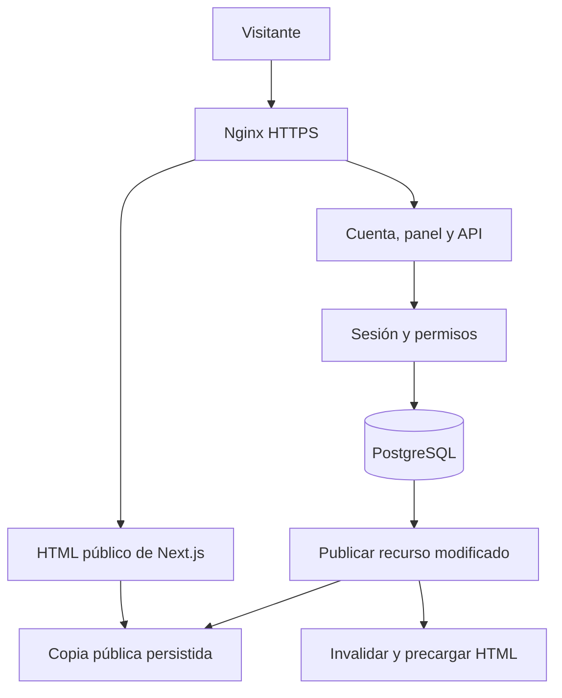

# JF-03 — Arquitectura de la aplicación y mapa de archivos

- **Identificador:** JF-03
- **Fecha de documentación:** 2026-11-05
- **Tipo de registro:** retrospectivo, contrastado con el código conservado
- **Origen principal:** b258773 y 0614d4d.

## Organización general

Jham-or utiliza una aplicación Next.js con dos formas de servir información. La tienda pública obtiene contenido de una publicación persistida y genera HTML estático. Las operaciones privadas verifican la sesión y trabajan contra PostgreSQL.

## Mapa principal

| Ruta del repositorio | Responsabilidad |
| --- | --- |
| `src/app/(store)` | Páginas de tienda, acceso, cuenta y compra. El grupo organiza archivos sin añadir `(store)` a la URL. |
| `src/app/admin` | Resumen y secciones administrativas protegidas. |
| `src/app/api/[...path]/route.ts` | Despachador de endpoints HTTP; valida método, origen, datos y permisos según la operación. |
| `src/app/media/[name]/route.ts` | Entrega de imágenes subidas con nombre permitido y caché larga. |
| `src/components/shop.tsx` | Proveedor de bolsa, cabecera, tarjetas, compra de producto y vista de bolsa. |
| `src/components/forms.tsx` | Acceso, registro, perfil y checkout. |
| `src/components/admin.tsx` | Navegación, editores, biblioteca de imágenes y edición de pedidos. |
| `src/components/catalog.tsx` | Búsqueda, filtros, orden y paginación pública en el navegador. |
| `src/lib/auth.ts` | Sesiones, permisos, errores de aplicación, límites de intentos y origen. |
| `src/lib/orders.ts` | Reglas transaccionales de creación y cambio de pedidos. |
| `src/lib/publication.ts` | Exportación consistente, revisiones, escritura y recuperación de la copia pública. |
| `src/lib/published.ts` | Tipos y lectura de la copia pública en memoria. |
| `src/lib/catalog.ts` | Lectores públicos con caché por etiqueta, sin importar Prisma. |
| `src/lib/publish-runtime.ts` | Une publicación, invalidación de Next.js y precarga posterior a la respuesta. |
| `src/lib/prewarm.ts` | Manifiesto y solicitudes internas de precarga. |
| `prisma` | Esquema, seed y migraciones. |
| `scripts` | Despliegue, arranque, copias, mantenimiento y verificaciones. |
| `infra` | Configuración Nginx fuente del proyecto. |
| `docs` | Guías, informes, evidencias y este historial. |
| `var` | Artefactos locales, registros y copias excluidos de Git. |

## Motivo de la separación

La UI no es la autoridad para precios, stock o permisos. Los formularios envían solicitudes y el servidor aplica las reglas. La publicación solo contiene datos públicos; una página estática no decide si un usuario puede administrar o confirmar un pedido.

El grupo `(store)` contiene también rutas privadas, pero estas declaran comportamiento dinámico. El layout público conserva estilos y estructura común sin convertir las sesiones en datos compartidos.

## Puntos de entrada útiles

Para cambiar una regla de compra, empezar por `src/lib/orders.ts` y su validación. Para cambiar qué aparece públicamente, revisar la exportación de `publication.ts` y sus lectores. Para añadir una sección administrativa, revisar tanto la página del panel como el endpoint que autoriza su escritura.

- [README del proyecto](../../README.md).
- [Publicación estática](JF-17-publicacion-estatica-y-consultas.md).
- [Panel administrativo](JF-10-panel-de-administracion.md).
